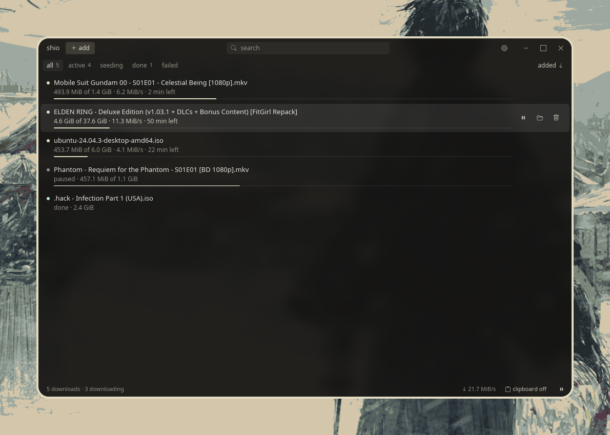

<div align="center">
  

  <h1>shio</h1>

  <p>modern download manager for links, torrents, and archives</p>

  <p>
    <a href="https://github.com/offs/shio/releases/latest/download/shio-x86_64.AppImage"><b>linux</b></a>
    ·
    <a href="https://github.com/offs/shio/releases/latest/download/shio-windows-x64.msi"><b>windows</b></a>
    ·
    <a href="https://github.com/offs/shio/releases/latest/download/shio-macos-arm64.zip"><b>macos</b></a>
  </p>
</div>

<p align="center">
  
</p>

## install

| platform | download | needs |
| --- | --- | --- |
| linux x86_64 | [appimage](https://github.com/offs/shio/releases/latest/download/shio-x86_64.AppImage) | glibc 2.35+ |
| windows x64 | [installer](https://github.com/offs/shio/releases/latest/download/shio-windows-x64.msi) · [portable](https://github.com/offs/shio/releases/latest/download/shio-windows-x64.zip) | windows 10+ |
| macos apple silicon | [zip](https://github.com/offs/shio/releases/latest/download/shio-macos-arm64.zip) | macos 11+ |

builds aren't signed yet, so smartscreen and gatekeeper will warn once.

## features

- direct links, magnet links, and .torrent files
- segmented downloads that survive restarts, with speed limits
- unpacks zip, 7z, tar, and rar, including multi-part sets
- seeding rules, tray, notifications, and opt-in clipboard detection
- a blurred window on wayland and macos

## themes

drop a `.toml` theme into shio's `themes` config folder and pick it in settings; start from one of the [built-in themes](assets/themes).

on noctalia, pick *noctalia* in settings and shio follows your wallpaper colours.
delete `~/.config/noctalia/shio.toml` to undo.

## build

needs rust 1.96+.

```sh
cargo build --release -p shio-app --locked
```

## license

[mit](LICENSE) · [third-party notices](packaging/THIRD_PARTY_LICENSES.md)
